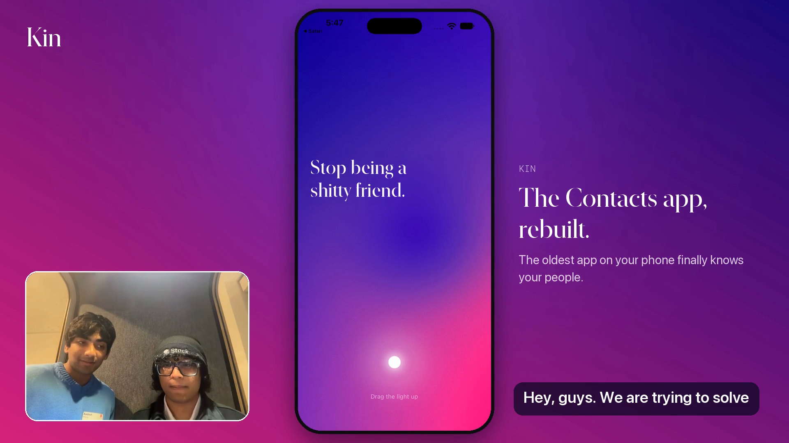
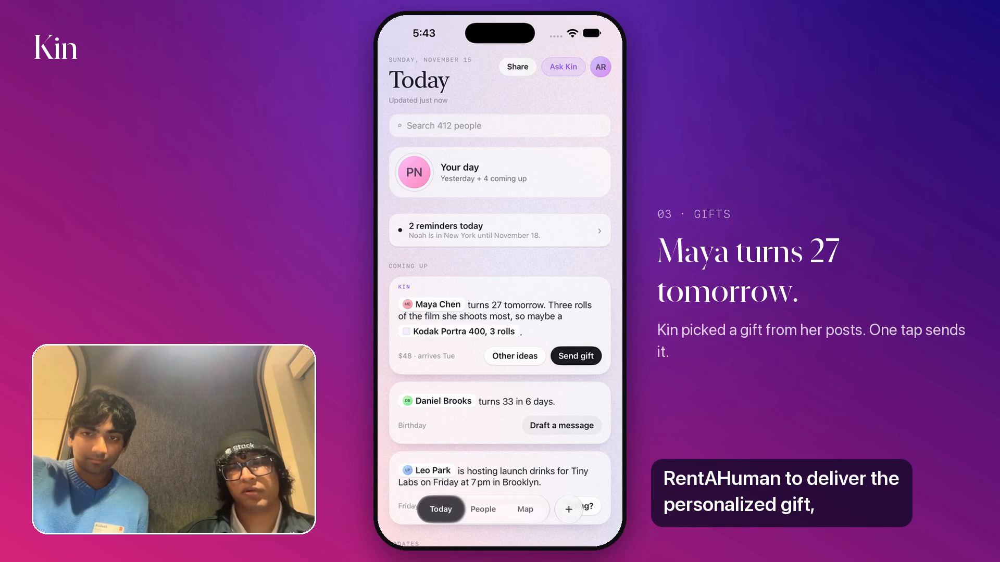
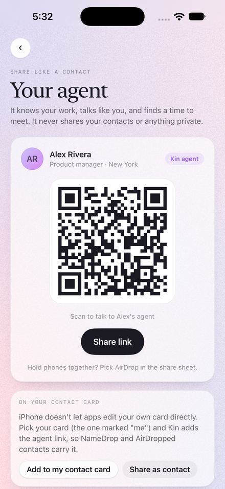
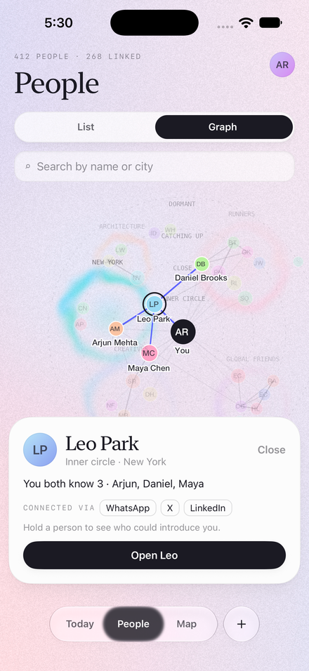

# Kin

**The Contacts app, rebuilt. Stop being a shitty friend.**

Built for the YC Consumer Mobile Hackathon (Nov 2026).



**Demo video:** [media/kin-demo.mp4](media/kin-demo.mp4) (3 min, subtitles in [media/kin-demo.srt](media/kin-demo.srt))

Your contacts app hasn't changed since 2007. Kin syncs your contacts, connects LinkedIn, X, Instagram, WhatsApp and iMessage, and indexes it all in Supermemory, so every contact knows what's going on with that person.

- **Your day:** one brainrot-style story a day recapping what your people did yesterday and what's coming up.
- **Today feed:** new jobs, moves, trips, races and birthdays, each with a one-tap action.
- **Gifts that deliver themselves:** tap Send gift and the agent buys it with a single-use Agentcard and hires a RentAHuman courier to wrap and deliver it. Your tap is the only spend approval.
- **People and graph:** closeness from your chats, who you both know, and a graph of your circles.
- **Map:** friends by city only, never an exact location.
- **Agentic contact card:** share your agent like a contact. It talks like you, shares only what you approve, and books time from your calendar.

| Gift run | Agent card | People graph |
| --- | --- | --- |
|  |  |  |

## Stack

Expo SDK 58 (iOS), Convex, Supermemory, Claude, ElevenLabs and Fish Audio, Agentcard, RentAHuman, Whop, Keiki, Composio, Exa, PDL, Firecrawl, Apify. More in [docs/](docs/).

## Run it

```bash
npm install --legacy-peer-deps
npx convex dev            # backend
npx expo run:ios          # app (development build)
```

Set `EXPO_PUBLIC_CONVEX_URL` in `.env`, and the provider keys as Convex environment variables (see `docs/`).
